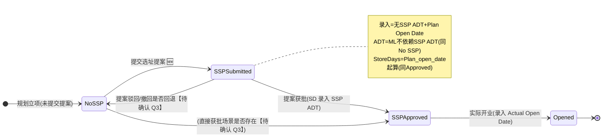
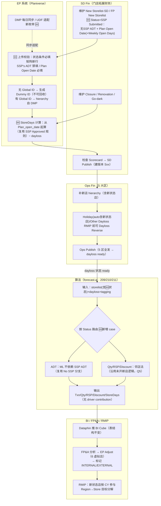
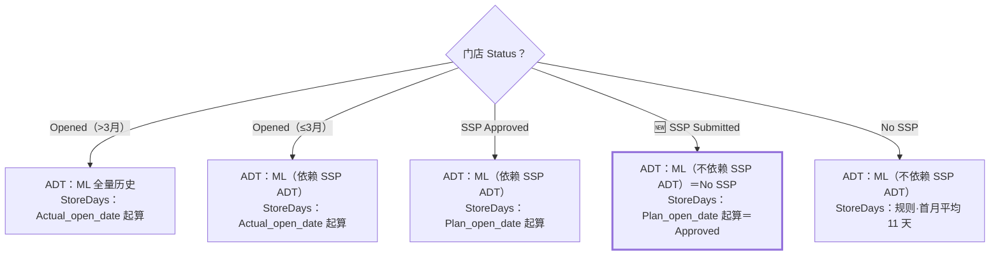

# 星巴克 EP 1.0 · 业务需求分析文档（BRD）
## Storelist 新店状态新增「SSP Submitted」· 需求编号 CR-2026-0618

| 项 | 内容 |
|---|---|
| 需求来源 | Jack Peng Ou（SBUX Finance Tech Manager）邮件「EP需求变更评估【紧急】」2026-06-18 |
| 需求一句话 | 在新店 Storelist 维护场景中，于 No SSP 与 SSP Approved 之间**新增第 4 种门店状态「SSP Submitted」**：ADT 预测逻辑同 No SSP（机器学习、不依赖 SSP ADT），Store Days 计算逻辑同 SSP Approved（从 Plan_open_date 起算） |
| 目标窗口 | 用于 **FY27 FP**；期望 **2026-07-10 前上线** |
| 关联文档 | ①《需求分析评估报告 v0》（同目录，2026-07-02）②内部系统侧工作量评估（赵富 · Confluence「门店新增 SSP Submitted 状态需求评估」，7 模块合计 34 人天，注：原页标题 "SSD" 为笔误）③金库 EP 1.0 知识库（真源引用见附录） |
| 版本 | v1 · 2026-07-02 · 杉数 EP 项目组（含【待确认】开口项，零编造） |

---

## 1. 背景与业务目标

### 1.1 业务背景
星巴克新店拓展遵循 **SSP（新店选址提案）审批漏斗**：规划立项（无提案）→ 提交提案 → 提案获批（SD 给出该店首年 SSP ADT 预估）→ 实际开业。EP 1.0 现有新店状态只有 3 档（No SSP / SSP Approved / Opened），**"已提交提案、尚未获批"的门店只能被迫归入 No SSP**——这类门店其实已有明确的 Plan Open Date（计划开店日），但按 No SSP 处理时 Store Days 走"首月平均 11 天"的粗规则，**营业天数与真实开店节奏脱节**，进而拉低该店的 Txn/Qty/Sales 预测质量。

随着新店计划管理复杂度加强（新店审批中间态门店数量与管理颗粒度上升），星巴克要求把这一中间态显式建模，赶在 **FY27 FP**（年度计划，P9 启动）用上。

### 1.2 业务目标
1. 新店状态从 3 档扩为 4 档，完整映射 SSP 审批漏斗；
2. "已提交未获批"门店的 **Store Days 精确到 Plan_open_date 起算**（复用 SSP Approved 逻辑），**ADT 不硬套不存在的 SSP ADT**（复用 No SSP 的 ML 路径）；
3. FY27 FP 及后续 Quarterly/BOE/Weekly/RMIP 各版本对新状态门店的预测与目标分解全链路可用；
4. 不劣化既有 3 状态门店的预测结果与系统行为（回归保障，锚定已交付基线 MLC 93%/店 86%）。

---

## 2. 现状基线（As-Is）

> 真源：金库 `03_算法方案与可解释性 §1`、`07_数据字典与假设`、`09_系统功能与架构 §2`、`12_EP系统操作手册`。

### 2.1 As-Is 新店三状态逻辑

| 门店状态 | 人工录入 | ADT 预测逻辑 | Store Days 逻辑 |
|---|---|---|---|
| **Opened** | >3月：无 SSP ADT；≤3月：有 SSP ADT；有 Actual Open Date | >3月：机器学习；≤3月：机器学习（依赖 SSP ADT） | 从录入的 **Actual_open_date** 起算 |
| **No SSP** | 无 SSP ADT，有 Plan Open Date | 机器学习（**不依赖** SSP ADT） | **基于规则，首月平均 11 天**（不依赖 Plan Open Date） |
| **SSP Approved** | 有 SSP ADT，有 Plan Open Date | 机器学习（**依赖** SSP ADT） | 从录入的 **Plan_open_date** 起算 |

补充口径（金库蓝图 V1.9 Table 10）：SSP Approved 的 Store Days 细则 = **首周按 Plan Open Date 落在周几起算天数，其余财月按 Weekly Open Days（每周营业 5/6/7 天）展开逐日 open/close**——这意味着"从 Plan_open_date 起算"**依赖 Weekly Open Days 字段**（见 FR-2/Q1）。

### 2.2 As-Is 涉及的系统模块地图（新状态将触碰的面）

```
SD/Ops 维护层        系统计算层                算法层              下游消费层
─────────────       ─────────────            ─────────           ─────────────
New Storelist-SD    状态条件必填校验          Status→分支路由      推送 BI（Dataphin）
New Storelist-Ops   Dummy ID / Global ID     ADT 预测(ML)        BI Cube（Store/AgeClass 维度）
FP SD / FP Ops      DMP 每日同步 + UDF        Qty/RSP/Discount    EP Adjust（6 虚拟店）
SD Dayloss/Reverse  StoreDays 计算            StoreDays 输出      RMIP（目标分解，归 CY 新店）
Ops Holiday/Other   Scorecard(Fcst/RMIP/Act) 209/210/211 三服务器 SCO/ARP 等（quantity 透明）
                    版本发布联动(S/V 版本)
```

---

## 3. 需求概述（To-Be）

### 3.1 To-Be 新店四状态定义（新增行加粗）

| 门店状态 | 人工录入 | ADT 预测逻辑 | Store Days 逻辑 |
|---|---|---|---|
| Opened | 同 As-Is | 同 As-Is | 从 Actual_open_date 起算 |
| No SSP | 无 SSP ADT，有 Plan Open Date | ML（不依赖 SSP ADT） | 规则·首月平均 11 天 |
| SSP Approved | 有 SSP ADT，有 Plan Open Date | ML（依赖 SSP ADT） | 从 Plan_open_date 起算 |
| **🆕 SSP Submitted** | **无 SSP ADT，有 Plan Open Date** | **ML（不依赖 SSP ADT）＝ No SSP 一致** | **从 Plan_open_date 起算 ＝ SSP Approved 一致** |

### 3.2 需求本质：两条已上线子逻辑的"正交组合"

SSP Submitted **不引入任何新算法、新公式**：
- **ADT 侧 ＝ No SSP 分支**（该店无 SD 估值，ML 自行从同城同商圈历史学习，不吃 SSP ADT 特征）；
- **StoreDays 侧 ＝ SSP Approved 分支**（该店有可信 Plan Open Date，营业日历按计划开店日精确展开）。

工程实质是：**①状态枚举加一个值 ②录入校验加一行规则 ③算法路由加一个 case（组合两条既有分支）④全链路各触点对新枚举"透明兼容 + 回归验证"**。这是本需求复杂度可控（系统侧评估 34 人天量级）的根本原因。

### 3.3 新店状态机（图 1）



**状态机口径（需求隐含、必须显式设计）**：状态是**单向漏斗为主**（No SSP → SSP Submitted → SSP Approved → Opened），但需确认：①能否跳档（No SSP 直接 → Approved）；②能否回退（Submitted 被驳回 → No SSP / 删除）；③跨预测版本迁移时（如 3+9F 里是 Submitted、6+6F 时已 Approved）Dummy ID 保持、逻辑按"当版状态"切换。

### 3.4 业务价值
| 维度 | 按 As-Is（挤进 No SSP） | 按 To-Be（SSP Submitted） |
|---|---|---|
| Store Days | 首月一刀切平均 11 天，与真实计划开店日脱节 | 首周按 Plan Open Date 精确起算 + Weekly Open Days 展开 |
| ADT | ML 不依赖 SSP ADT（同） | ML 不依赖 SSP ADT（同，无变化） |
| 净效果 | Txn=ADT×StoreDays 的 **StoreDays 分量失真** | StoreDays 贴近真实 → 该店 Txn/Qty/Sales 预测更准，FY27 FP 新店盘子更可信 |
| 管理 | 审批中间态不可见 | 状态即审批进度，Storelist 成为新店漏斗的单一视图 |

---

## 4. 详细业务需求（FR 编号）

### FR-1 门店状态枚举与状态机
- FR-1.1 `Status` 枚举由 {No SSP, SSP Approved, Opened} 扩为 **{No SSP, SSP Submitted, SSP Approved, Opened}**；所有出现 Status 的下拉/列表/详情/导出同步。
- FR-1.2 状态迁移规则按 §3.3 状态机实现；迁移时**不重新生成 Dummy ID**（沿用原 ID，仅逻辑路由切换）；Submitted→Approved 时强制补录 SSP ADT（校验联动）。
- FR-1.3 【待确认 Q3】回退/跳档场景与删除规则。

### FR-2 Storelist 维护模块（SD / Ops / FP，对应评估表 "Storelist" 6 人天）
- FR-2.1 **New Storelist-SD**：上传模板 / 页面新增(Add) / 编辑 / 下载，Status 支持 SSP Submitted；**条件必填矩阵新增一行**：

| Status | Plan Open Date | Plan Open Month | Weekly Open Days | SSP's ADT | Actual Open Date |
|---|---|---|---|---|---|
| No SSP | 必填 | 必填 | 非必填（填则 5~7） | 禁填/置空 | — |
| **🆕 SSP Submitted** | **必填** | 必填 | **建议必填 5~7【待确认 Q1】** | **禁填/置空（填了报错或忽略）** | — |
| SSP Approved | 必填 | — | 必填 5~7 | **必填**（整数、≠0） | — |
| Opened | — | — | <1月必填 0~7 | <3月必填 | 必填 |

  > Q1 依据：StoreDays 从 Plan_open_date 起算的细则需要"每周营业几天"才能逐日展开（蓝图 Table 10 SSP Approved 行明确使用 Weekly Open Days）。若客户不愿必填，则需约定缺省值（如默认 7 天）——**二选一必须定死，否则 StoreDays 算不出来**。
- FR-2.2 **Dummy ID / Global ID**：SSP Submitted 属 CY 未开新店，复用现有规则——无 Global ID 按 City 自动生成 Dummy ID（9+四位城市码+三位流水号，不可回收）；有 Global ID 则 hierarchy 自 DMP 带出、须在 DMP 存在。**评估表已标"优先明确 SSP Submitted 是否有特殊校验"——本 BRD 立场：除 FR-2.1 必填行外无特殊校验，与其他 CY 新店一致【待客户确认 Q2】。**
- FR-2.3 **New Storelist-Ops**：Ops 按区补 hierarchy（Store Name/L1/L2/District/Trade Zone），对新状态店与现有 CY 店一致；不增删行、Dummy ID 不删。
- FR-2.4 **FP 场景（FY27 FP 的主战场）**：FP New Storelist-SD 上传（FY26 P9-P12 + FY27 新店）支持 SSP Submitted；FP Existing Storelist 不涉及（只含已开店）；FP Ops hierarchy 同 FR-2.3；[Update]/[Clear] 清空逻辑对新状态记录一并生效。
- FR-2.5 Storelist Calendar / Storelist Review / 下载导出对新状态透明展示。

### FR-3 DMP 数据接入与 DMP Maintenance（对应评估表 "DMP 数据接入" 2 人天 + "DMP Maintenance" 6 人天）
- FR-3.1 **每日 DMP 门店数据定时同步**适配新类型：同步/映射逻辑遇到新状态值不丢弃、不报错、正确落库（含 dmp_storeinfo、UDF 层 DMP Modification 的 Status 字段）。
- FR-3.2 **DMP Maintenance（UDF）**：Existing/SD/Ops/FP SD/FP Ops 各页签的上传、下载、编辑、校验对 Status 新枚举适配（UDF 覆写规则不变：有值覆写、无值沿 DMP）。
- FR-3.3 【待确认 Q4】**SSP Submitted 状态的权威数据源**：是 SD 在 EP 手工维护，还是 DMP/SD One 侧已有"已提交"标记需同步映射？（评估表把"DMP 数据接入适配新类型"列为改造点，暗示 DMP 侧可能出现该状态值——两边口径须对齐，避免同步覆盖手工维护。）

### FR-4 StoreDays 计算（系统侧，对应评估表 "Scorecard" 5 人天的计算部分）
- FR-4.1 SSP Submitted 的 StoreDays **完全复用 SSP Approved 算法**：`首周 = 按 Plan Open Date 落位起算天数；其余财月 = 按 Weekly Open Days 逐日展开 open/close`；再走统一的 `Final Storeday = Base − SD dayloss − Ops dayloss + 重复关店天 (+RMIP Reverse)`。
- FR-4.2 **系统侧 Scorecard 口径与算法侧输出口径必须一致**（双侧都算 storeday：系统 Dayloss Result/Scorecard 供发布校验，算法 bi_dw_fcst_txn_storedays 供预测输出）——新增状态后双侧同源同规则，纳入比对测试。

### FR-5 DayLoss 适配（对应评估表 "DayLoss" 2 人天）
- FR-5.1 **SD Dayloss / Dayloss Reverse**：新状态店可被维护 Closure/Reno/Go-dark；RMIP 前 Ops 的 Reverse 页对新状态店正常展示与反转。
- FR-5.2 **Ops Holiday Dayloss（auto 类）**：系统按 SD 新店开店天数自动生成 holiday dayloss 行——生成逻辑需覆盖 SSP Submitted 店（其有 Plan Open Date + Weekly Open Days，具备生成条件）。
- FR-5.3 Dayloss 两套结果口径不变（For Forecast=SD∪Ops；For RMIP=Ops 优先），新状态店随 CY 新店走。

### FR-6 算法输入与预测逻辑（对应评估表 "算法对接" 3 人天＝输入适配；**算法侧模型路由改造另评**）
- FR-6.1 **输入数据适配（系统→算法）**：传给算法的 storelist（STORE_INFO / storelist-cy 通道）携带新 Status 值；算法 ETL/解析（ep_etl）接受该枚举不报错。
- FR-6.2 **算法路由（算法团队范围）**：按 Status 分流新增 SSP Submitted case——`ADT → 调用 No SSP 的 ML 路径（不依赖 SSP ADT）`；`StoreDays → 调用 SSP Approved 路径（Plan_open_date 起算）`；209/210/211 三服务器代码同步发布。
- FR-6.3 **Qty / RSP / Discount**：邮件未提；建议沿用未开新店现行逻辑（同城同商圈邻店 UPT × 本店预测 Txn；Discount 取邻店均值；RSP N/A→上市后同口径），即与 No SSP 一致【待确认 Q5】。
- FR-6.4 输出结构不变：新状态店同其他未开新店，**无 driver contribution**（`指标 = Baseline + Tactics`），PRED_TYPE/表结构零改动。

### FR-7 Scorecard 适配（对应评估表 "Scorecard" 5 人天）
- Forecast Scorecard / RMIP Scorecard / Actual StoreDays 三类对新状态店的 storeday 正确汇总展示（MLC/Region/Store 层级、Summary 周/月/季/年）；Store Count / Period Ending Store Count 统计口径把新状态店按 CY 计入。

### FR-8 版本发布与联动（回归为主，无新逻辑）
- SD Publish（Sxx）/ Ops Publish / Trendline Running（Sxx-a）版本机制不变；改新状态店的 storelist 记录同样触发既有 unpublish 联动（改清单→SD&Ops 全部重发布）；Input Status 页 storeday/tagging 状态检查兼容。

### FR-9 下游兼容（推 BI / RMIP / BI Cube / 其他系统）
- 推 BI 表结构零改动（storeday/txn 数值随新逻辑变化而已）；BI Cube Store/Age Class 维度将新状态店按 CY 新店归类；RMIP 拆分把新状态店当普通 CY 门店参与 Region→Store 分摊与锁定；SCO/ARP 等下游消费 quantity 透明无感。

---

## 5. To-Be 端到端业务流程（把新状态串进全链）

### 5.1 端到端泳道流程图（图 2，🆕 标注新状态触点）



### 5.2 状态 → 预测逻辑路由决策图（图 3）



### 5.3 FY27 FP 场景走查（本需求的首个实战路径，step-by-step）

1. **SD**：9+3F 发布后，FP 模块点 [Update] 自动生成 FP Existing Storelist（只含已开店，不涉新状态）；在 **FP New Storelist-SD** 上传 FY26 P9-P12 + FY27 新店——其中"已提交提案未获批"门店 **Status=SSP Submitted**（无 SSP ADT、必填 Plan Open Date、Weekly Open Days 按 Q1 结论）。
2. **系统**：条件必填校验（🆕新行）→ 无 Global ID 生成 Dummy ID → DMP 同步/UDF 兼容新枚举。
3. **Ops（5 区）**：FP New Storelist-Ops 补 hierarchy（不增删行、Dummy ID 不删）。
4. **SD**：维护 FY27 Closure/Reno/Go-dark；**系统对新状态店从 Plan_open_date 起算 storeday**（首周按开店日、余月按 Weekly Open Days），Ops Holiday auto 类 dayloss 自动生成。
5. **SD Publish**（FY27 FP S01）→ **5 区 Ops Publish** → dayloss 状态 ready。
6. **发起 FP Trendline**（FY27 FP V0a）：算法读入含新状态的 storelist，ADT 走"不依赖 SSP ADT"的 ML 分支，Qty/RSP/Discount 按邻店法，StoreDays 用 Plan_open_date 口径 → 输出无 driver contribution 的新店预测。
7. **推 BI → FP&A 分析 → EP Adjust**（6 虚拟店调整）→ 版本标记 INTERNAL/EXTERNAL → （季度内）RMIP 分解到店。
8. **状态流转（跨版本）**：某店提案获批 → SD 把 Status 改为 SSP Approved 并**补录 SSP ADT** → 下一版 Trendline 该店 ADT 自动切换到"依赖 SSP ADT"分支（Dummy ID 不变）；实际开业 → Opened + Actual Open Date → 月度 Actualize 用真实数据覆盖。

### 5.4 一家 SSP Submitted 门店的跨版本生命周期（叙事）
`FY27 FP（Submitted，Plan 2027-01-15 开店）→ FY27 3+9F（获批→Approved，SSP ADT=130）→ FY27 6+6F（已开业→Opened，Actual 2027-01-20）→ P5 起 Actualize 逐月回填实际`——同一 Dummy ID→Global ID 贯穿，四个版本四种取数逻辑自动切换，这正是状态机 + 路由设计（FR-1/FR-6）要保证的连续性。

---

## 6. 数据与校验规则明细（开发/测试直接可用）

| # | 规则 | 类型 |
|---|---|---|
| V1 | Status 枚举含 `SSP Submitted`，上传/页面/接口三处一致 | 枚举 |
| V2 | Status=SSP Submitted：Plan Open Date 必填（yyyy-MM-dd / yyyy/MM/dd） | 必填 |
| V3 | Status=SSP Submitted：SSP's ADT 必须为空（填值→报错或按约定忽略【与 Q2 一并定】） | 互斥 |
| V4 | Status=SSP Submitted：Weekly Open Days 必填 5~7（或缺省 7，按 Q1 结论） | 必填/缺省 |
| V5 | Submitted→Approved 状态变更时：SSP ADT 变必填（联动校验） | 迁移 |
| V6 | 无 Global ID → Dummy ID 生成规则不变（9+城市码+流水号，不可回收）；有 Global ID → 须在 DMP、City 变更拒绝 | 复用 |
| V7 | 新状态店的 storeday：系统 Scorecard 口径 = 算法输出口径（抽样比对） | 一致性 |
| V8 | Ops Holiday auto 类 dayloss 对新状态店正确生成 | 派生 |
| V9 | 改新状态店清单 → 触发既有 unpublish 联动（SD&Ops 全部重发布） | 联动 |
| V10 | FP [Update]/[Clear] 对新状态记录一并清空 | FP |

---

## 7. 改造点与工作量映射（对齐系统侧评估 34 人天）

> 基准：赵富《门店新增 SSP Submitted 状态需求评估》（Confluence，2026-07）。**该评估为系统侧（Planiverse）口径，已注明"不包含需求调研与产品设计"。**

| 评估模块 | 评估内容 | 前端 | 开发 | 测试 | 小计 | 对应本 BRD |
|---|---|---|---|---|---|---|
| DMP 数据接入 | 定时同步 DMP 门店数据适配新类型 | 0 | 1 | 1 | **2** | FR-3.1 |
| DMP Maintenance | Existing/SD/Ops/FP SD/FP Ops 上传·下载·编辑·校验适配 | 1 | 3 | 2 | **6** | FR-3.2 |
| Storelist | Existing/SD/Ops/FP Existing/FP SD/FP Ops 上传·新增·编辑适配；**优先明确是否有特殊校验** | 1 | 3 | 2 | **6** | FR-1 / FR-2（Q2） |
| DayLoss | SD Dayloss Reverse 适配、Ops Holiday Dayloss 适配 | 0 | 1 | 1 | **2** | FR-5 |
| Scorecard | Forecast / RMIP Scorecard、Actual StoreDays 适配 | 0 | 3 | 2 | **5** | FR-4 / FR-7 |
| 算法对接 | 提供给算法的**输入数据**适配 | 0 | 1 | 2 | **3** | FR-6.1 |
| Trendline 全流程测试 | Forecast / RMIP / BOE Trendline 全流程 | 0 | 0 | 10 | **10** | FR-8/9 + §9 |
| **合计** | | **2** | **12** | **20** | **34** | |

**评估范围缺口（报价/排期须补齐的四块）**：
1. **需求调研与产品设计**——评估表已自注不含；
2. **算法侧改造**——表内"算法对接"仅为系统侧输入适配（3 人天）；**算法路由 case、No SSP/Approved 分支组合、三服务器发布与算法回归（FR-6.2）需算法团队单独评估**；
3. **交付文档更新**——蓝图/算法方案/数据字典/用户手册（及金库操作手册 12）的状态枚举与逻辑表更新；
4. **上线与 hypercare**——Golive checklist 执行、FY27 FP 首跑护航。

**时点提示**：距 7.10 目标约 1 周，34 系统人天 + 算法侧需多角色并行压缩；若吃紧，建议 MVP 分批——**第一批（FY27 FP 必需）**：FR-1/2/3.1/4/6 + 核心回归；**第二批**：Scorecard 细节增强、Reverse 边界、全量 UAT 扫尾。

---

## 8. 开口项与关键假设（开发前必须定死）

| # | 开口项 | 影响 | 建议 |
|---|---|---|---|
| Q1 | SSP Submitted 的 **Weekly Open Days 必填 or 缺省 7 天**？ | StoreDays 逐日展开的输入 | 建议按 SSP Approved 口径必填 5~7 |
| Q2 | 除必填矩阵外**是否有特殊校验**（评估表自标"优先明确"）？ | Storelist 6 人天的范围 | 建议无特殊校验，与 CY 新店一致 |
| Q3 | **状态机边界**：可否跳档（No SSP→Approved）？可否回退（Submitted 驳回）？ | FR-1 设计与测试 | 建议允许任意前向迁移 + 驳回回退 No SSP |
| Q4 | **新状态权威数据源**：SD 手工维护 or DMP/SD One 同步下发？两边冲突谁赢？ | FR-3 同步方向 | 建议 EP 手工为准、同步只做兼容不覆盖 |
| Q5 | **Qty/RSP/Discount** 是否沿用 No SSP（邻店法）？ | FR-6.3 算法范围 | 建议沿用（邮件仅约束 ADT+StoreDays） |
| Q6 | **验收口径**：新状态店是否单独考核准确率？ | SOW/测试 | 建议参照 Core/LTO 先例：不单独考核，整体不劣化 |

**关键假设**（默认成立，澄清会推翻则改设计）：①复用两条既有分支、无新模型；②新状态归 CY 新店，Dummy ID/RMIP/BI 处理与现有 CY 一致；③无 driver contribution；④推 BI 表结构零改动。

---

## 9. 测试与验收要点（对应"Trendline 全流程测试 10 人天"）

1. **正测**：SSP Submitted 店在 Forecast Trendline / RMIP Trendline / BOE 三条全流程端到端（上传→校验→publish→算法→scorecard→推 BI→RMIP 分解）。
2. **回归**：既有 3 状态门店结果与系统行为零变化（锚定 MLC 93%/店 86% 基线，抽样比对新旧版本输出）。
3. **口径一致性**：新状态店 storeday 系统 Scorecard vs 算法输出逐店比对（V7）。
4. **状态迁移**：Submitted→Approved→Opened 跨版本连续性（Dummy ID 不变、逻辑切换、SSP ADT 联动必填）。
5. **边界/负测**：Submitted 填 SSP ADT（V3）、缺 Plan Open Date（V2）、Weekly Open Days 越界、FP [Update]/[Clear] 清空、改清单触发全区重发布（V9）、Dummy ID 不可回收行为。
6. **数据质量抽检**：参照历史教训（门店 78825 storeday 失真致准确率异常），对首批 SSP Submitted 店抽样人工核对 Plan Open Date/Weekly Open Days 与 storeday 展开结果。

---

## 附录 · 真源引用（金库 EP 1.0 知识库，只读）
`04_实例库/项目/星巴克EP/`：11_需求变更与CR动态（CR-2026-0618）· 03_算法方案与可解释性 §1（四状态路由）· 09_系统功能与架构 §2（Storelist/Dummy·Global ID/发布联动）· 07_数据字典与假设（字段矩阵/枚举）· 12_EP系统操作手册（端到端 10 步）· 05_场景增强与RMIP · 08_商务合同与交付里程碑（人天单价/验收先例）。方法：M-004 方案设计 / M-007 数据可行性 / M-009 范围管理（引 ID）。

---

*BRD v1 · 2026-07-02 · 含【待确认】Q1–Q6，零编造；系统侧 34 人天为赵富评估口径（不含需求调研/产品设计/算法侧路由改造/文档/护航）。对客版须去内部脚手架后另出。*
