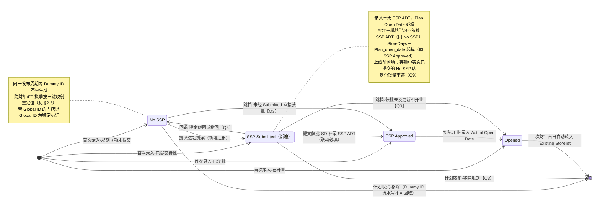
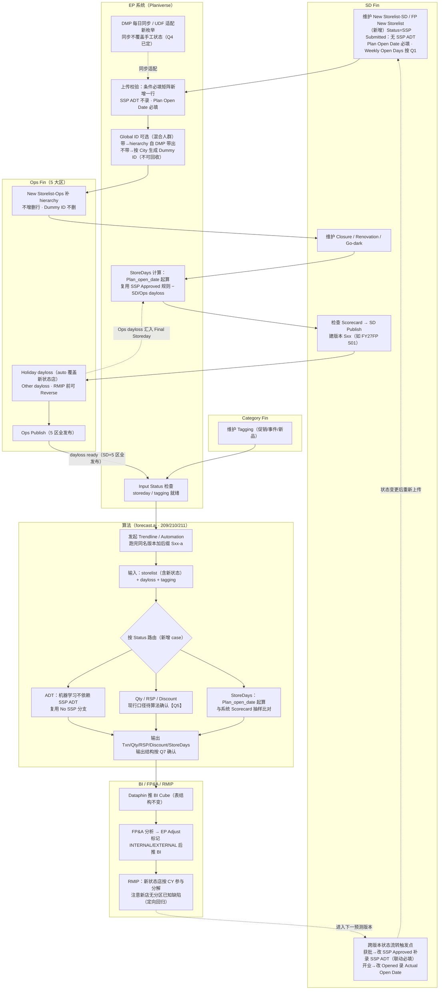
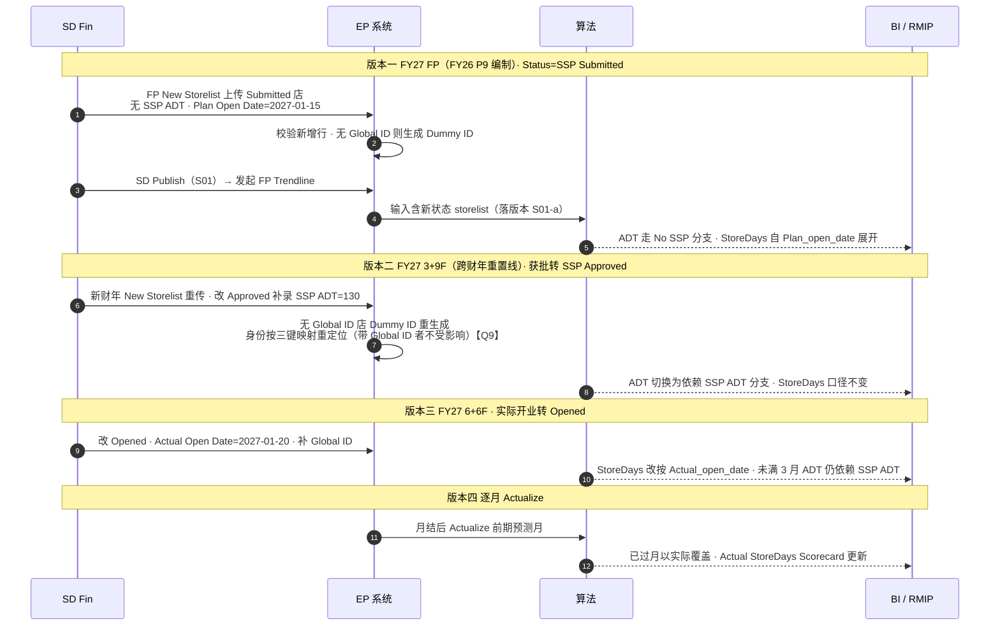
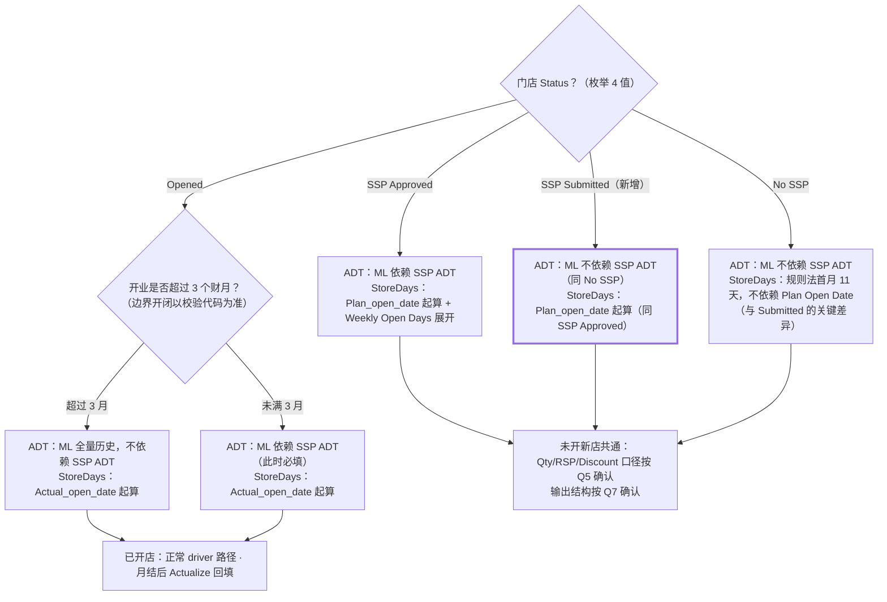

# 星巴克 EP 1.0 需求分析文档
## Storelist 新店状态新增 SSP Submitted（CR-2026-0618）

| 项 | 内容 |
|---|---|
| 需求来源 | Jack Peng Ou（星巴克 Finance Tech Manager）邮件，2026-06-18；口头澄清补充，2026-07-02 |
| 需求摘要 | 在新店 Storelist 中新增第四种门店状态 **SSP Submitted**，介于 No SSP 与 SSP Approved 之间：ADT 预测沿用 No SSP 逻辑（机器学习，不依赖 SSP ADT）；Store Days 沿用 SSP Approved 逻辑，自 Plan_open_date 起算 |
| 目标窗口 | FY27 FP 首用；期望 **2026-07-10** 前上线 |
| 版本 | v2 · 2026-07-02 · 杉数 EP 项目组。开口项以【待确认 Qx】标出；口径引自需求邮件、原始交付文档与项目知识库，推断处已单独标注 |
| 关联文档 | 系统侧工作量评估（赵富，Confluence，7 模块 34 人天）；需求澄清补充（2026-07-02）；v1 及多镜头评审记录（同目录） |

---

## 0. 决策摘要

**要什么**：新店状态从 3 档扩为 4 档，新增 SSP Submitted（无 SSP ADT，有 Plan Open Date；ADT 走 No SSP 的机器学习路径，Store Days 从 Plan_open_date 起算）。全文口径以 §1 对照表为准。

**为什么**："已提交董事会、尚未获批"的门店目前只能归入 No SSP，Store Days 按"首月平均 11 天、其余月 28/35 天"的规则估算，偏离真实开店节奏，该店 Txn/Qty/Sales 预测质量随之下降，影响 FY27 FP 新店盘子（注：现状归类方式为推断，需向 Jack/SD 确认，见 Q11）。

**定位判断**：不引入新算法。改造集中在状态枚举、录入校验、算法路由和全链路兼容四处，与系统侧 34 人天的评估量级相符。两点澄清让它不是纯粹的"加枚举"：状态无法从上传数据推导（只能 SD 人工录入，错标不可拦截）；SSP Submitted 门店部分带、部分不带 Global ID（店号子流程独立于董事会提交）。

**量级**：系统侧 34 人天（前端 2 / 开发 12 / 测试 20，7 模块）。明确不含五块：需求调研与产品设计、算法侧路由与建模改造（另评 X 人天）、交付文档与培训、上线护航、**商务载体**（CR 运维合同 2026-06-30 已到期，本单以何种合同通道执行需先与 Gavin Li 确认）。报价按 34+X 谈。

**时间**：距 07-10 约一周。建议分批：第一批（FY27 FP 必需）＝枚举、校验、StoreDays 计算、算法输入与路由、核心回归；第二批＝Scorecard 细节、监控告警、全量 UAT。配业务级回退预案（异常时 Submitted 店批量改回 No SSP 重发布重跑，功能代码不回滚）。

**三大技术风险**：Q1 不定（Weekly Open Days 必填还是缺省 7 天）则 StoreDays 无法逐日展开；Qty 现行口径存在双真源冲突（Q5，本 CR 藏得最深的缺口）；既有 3 状态门店零劣化，锚定已验收基线 MLC 93%／门店 86%。

**本周动作**：07-04 前客户书面确认 P0 开口项（§4 确认单，附建议答案可直接勾选）；07-04 前算法团队补评改造人天并确认 Qty 现行代码口径；07-07 锁定 SOW 与分批排期。

---

## 1. 需求定义与价值

### 1.1 四状态对照表（全文唯一口径源）

| 门店状态 | 人工录入 | Global ID | ADT 预测 | Store Days |
|---|---|---|---|---|
| Opened | 超过 3 月：无 SSP ADT；未满 3 月：有 SSP ADT；有 Actual Open Date | 有（已开业） | 机器学习（未满 3 月依赖 SSP ADT） | Actual_open_date 起算 |
| No SSP | 无 SSP ADT，有 Plan Open Date | 通常无 → Dummy ID | 机器学习，不依赖 SSP ADT | 规则法：首月平均 11 天，其余月 28/35 天，不依赖 Plan Open Date |
| SSP Approved | 有 SSP ADT，有 Plan Open Date | 可有可无 | 机器学习，依赖 SSP ADT | Plan_open_date 起算 |
| **SSP Submitted（新增）** | 无 SSP ADT，有 Plan Open Date | **可选（混合人群）**：带则 hierarchy 自 DMP 带出，不带则按 City 生成 Dummy ID | 机器学习，不依赖 SSP ADT（与 No SSP 一致） | Plan_open_date 起算（与 SSP Approved 一致） |

注：三个月边界在各来源中写法不一（≤3 月与 <3 月混用），开闭区间以系统现行校验代码为准，本文统一写"未满 3 月／超过 3 月"。

### 1.2 两点关键澄清（2026-07-02，决定设计走向）

1. **状态不可推导**。SSP Submitted 由星巴克新店计划管理的线下子流程（是否已提交董事会）决定，EP 上传数据中没有任何字段组合能识别它。因此状态只能由 SD 人工录入；系统只能校验字段组合合法性，不能校验状态真伪——错标无法拦截，需靠录入 SOP 与抽检兜底（见 §3.4、§7）。DMP 每日同步不得覆盖手工状态。
2. **状态与店号解耦**。店号（Global ID）来自独立的店号申请子流程，与董事会提交互不影响。SSP Submitted 门店是混合人群：部分带店号、部分不带。状态迁移不要求店号变化，店号也可在任意状态下补录（补录不触发状态变化）。带店号的门店以 Global ID 为跨版本稳定标识。

### 1.3 价值

按 To-Be，此类门店的 Store Days 自计划开店日精确展开，Txn＝ADT×StoreDays 中失真的 StoreDays 分量得到修正；同时 Storelist 的状态列成为新店审批漏斗的可视视图。ADT 侧与现状无差异。

---

## 2. 状态机与身份连续性

### 2.1 状态机（图 1）

说明：Storelist 为整表替换、SD 按门店现状直接声明状态，故四个状态均可作为首次录入入口；测试用例不应只覆盖"从 No SSP 长出来"的路径。

### 2.2 迁移规则

- 前向迁移（Submitted→Approved→Opened）为主线；Submitted→Approved 时 SSP ADT 转为必填（联动校验）。
- 跳档（No SSP→Approved、Submitted→Opened）与回退（Submitted→No SSP）、整店取消（删除）是否放开，见【Q3】——建议按 4×4 迁移矩阵逐格定"允许／禁止／联动校验"。删除需提示 Dummy ID 占号后果（流水号删除后被占用，次年 3+9F 才恢复）。
- Submitted→Opened 直跳时注意：Opened 未满 3 月的 ADT 依赖 SSP ADT，而 Submitted 店没有 SSP ADT，跨两档迁移的联动校验必须覆盖。

### 2.3 跨版本身份连续性（v1 的一处更正）

v1 曾表述"同一 Dummy ID 贯穿四个版本"，与现行机制不符，更正如下：

- 同一发布周期内，状态迁移不重新生成 Dummy ID；
- 跨财年与 FP 换季场景，New Storelist 清空重传，无 Global ID 门店的 Dummy ID 会重新生成，门店身份按三键映射（Plan Open Date＋City＋Store Name）重定位——注意 Plan Open Date 恰是本状态的核心可变字段，期间被顺延过则映射会断；
- 带 Global ID 的门店不受此影响，Global ID 是稳定标识。这也是鼓励 SD 在店号子流程走完后及时补录 Global ID 的理由。
- 跨版本身份策略（映射键、顺延后的处理）需系统侧确认，见【Q9】。

---

## 3. 范围、工作量与排期

### 3.1 系统侧评估映射（34 人天）

| 评估模块 | 内容 | 前端 | 开发 | 测试 | 小计 | 对应需求 |
|---|---|---|---|---|---|---|
| DMP 数据接入 | 定时同步适配新类型 | 0 | 1 | 1 | 2 | FR-3 |
| DMP Maintenance | Existing/SD/Ops/FP 各页上传下载编辑校验适配 | 1 | 3 | 2 | 6 | FR-3 |
| Storelist | 各模块上传新增编辑适配；是否有特殊校验（已半落定，见 Q2） | 1 | 3 | 2 | 6 | FR-1/2 |
| DayLoss | SD Dayloss Reverse、Ops Holiday Dayloss 适配 | 0 | 1 | 1 | 2 | FR-5 |
| Scorecard | Forecast/RMIP Scorecard、Actual StoreDays 适配 | 0 | 3 | 2 | 5 | FR-7 |
| 算法对接 | 提供给算法的输入数据适配 | 0 | 1 | 2 | 3 | FR-6（输入侧） |
| Trendline 全流程测试 | Forecast/RMIP/BOE 全流程 | 0 | 0 | 10 | 10 | §7 |
| 合计 | | 2 | 12 | 20 | **34** | |

两处需与评估方对齐：其一，"新状态店 StoreDays 从 Plan_open_date 起算"这条核心计算改造，系统侧（Store Days Automation）与算法侧（storeday 后处理、bi_dw_fcst_txn_storedays 输出）双侧都有，7 个模块中没有明确成本落点，须确认归属或给出"复用 SSP Approved 分支零代码改动"的代码级证据；其二，全流程测试行未含 Weekly OL（见 §3.3）。

### 3.2 评估范围外的五块缺口

1. 需求调研与产品设计（评估表自注不含）。
2. 算法侧改造：路由新增 case、Qty 口径确认与实现（Q5）、ML 化后输出行为确认（Q7）、三服务器发布与算法回归——需算法团队另评人天。
3. 交付文档与培训：蓝图/算法方案/数据字典/用户手册更新；SD 录入判定 SOP（什么店该标 Submitted，与状态不可推导直接相关）；上传模板换版与旧模板处理策略；培训对象含 SD/Ops/FP&A 及交接中的星巴克深圳团队，且须在 FY27 FP 录入开始前完成。
4. 上线护航与监控（FR-11，第一批可人工代偿）。
5. **商务载体**：CR 运维合同 2026-06-30 到期不续，主合同运维已收窄为故障响应，交接立场为"新需求开发仅指导不代劳"——本单 34+X 人天由谁在什么合同下执行，报价前须与甲方 SOW 联系人 Gavin Li 确认通道，并在 SOW 中划清上线后 hypercare 与交接期职责边界。

### 3.3 在途变更的依赖与发布时序

三个变更共享算法代码与 209/210/211 服务器，需统一 release 计划：

| 在途项 | 状态 | 与本 CR 的接触面 |
|---|---|---|
| Core & LTO（CR8，¥877,510，SOW ¥835,958） | 合同审批中 | 算法侧含 New store modeling；上线后 Qty/RSP/Discount 下探到 lto/core 两层，新状态店在该颗粒度下的输出口径需一并回答（并入 Q5）；Docker 化改造同一批服务器 |
| Anaplan 对接 CR（¥86,666，已签，计划 2025-07~08 上线） | 需核实是否已上线 | 替换 EP Adjust 通道；若已上线，FR-10 的 EP Adjust 兼容需在手工 Frank 与 Anaplan API 两条通道各验一遍 |
| 本 CR | 评估中 | 分支合并顺序、回归基线选择须与上述两项对齐 |

### 3.4 上线切换与存量数据处理

- **存量重述**：上线时既有 storelist 中实态"已提交"却记为 No SSP 的门店，是否批量重分类、清单谁提供、涉及多少家【Q9】。不重述则 FY27 FP 首跑吃不到本 CR 的价值。建议由 SD Fin 提供清单并经页面重传（走校验），不做脚本直改库。
- **历史版本兼容**：在途已发布版本（Sxx/Sxx-a）全是 3 态数据，Storelist Review／Scorecard Review 回看、以及 BOE/Weekly/Actualize"选旧 Trendline 版本数据"重算，须对旧枚举向后兼容，列入回归。
- **迁移窗口**：重述改 storelist 会触发全区 unpublish 连锁（SD 改任一店新店清单，所有 region 重新 publish），部署与迁移须避开周度 OL 运行与季度收口，列出重发布顺序。
- **回退预案**：以业务级降级为主——异常时把 Submitted 店批量改回 No SSP、重发布重跑，功能代码保留不回滚；FP [Clear] 只回退 FP 模块数据，不是功能回滚，二者不可混用。明确回滚触发条件、责任人与 FY27 FP 定版前的最晚决策点，并做一次演练。
- **状态错标兜底**：状态真伪系统无法校验（§1.2），SD 录入 SOP＋状态分布周报＋抽检是唯一防线。

---

## 4. 开口项确认单

已关闭：**Q4 状态权威数据源**——SD 人工录入为准，系统不做自动识别与默认推导，DMP 同步不得覆盖（2026-07-02 澄清）。

**P0（开工前必答，建议 07-04 前书面确认）**

| # | 问题 | 影响 | 建议答案 | 拍板人 |
|---|---|---|---|---|
| Q1 | SSP Submitted 的 Weekly Open Days 设为必填，还是缺省按 7 天处理？ | StoreDays 逐日展开的输入 | 按 SSP Approved 口径必填 5~7 | Jack/SD Fin |
| Q2 | 除必填矩阵与"状态不可推导、Global ID 可选"两点外，是否还有其他特殊校验？ | Storelist 6 人天范围 | 无其他特殊校验 | Jack/系统侧 |
| Q3 | 状态迁移矩阵：跳档（No SSP→Approved、Submitted→Opened）、回退（Submitted→No SSP）、整店删除，各格允许还是禁止？ | 状态机实现与测试 | 允许前向任意迁移与驳回回退；删除提示 Dummy ID 占号 | Jack/SD Fin |
| Q5 | 无 SSP ADT 门店的 Qty/RSP/Discount 现行代码口径是什么？（两份交付文档不一致：蓝图 V1.9 为邻店法；算法方案 V1.1 为 Baseline×ADT Ratio，无 SSP ADT 时用同城 Approved 店 SSP ADT 均值填充分母；ML 化后以代码为准。另：SSP Submitted 落 storelist-pybase 还是 storelist-cy 通道、ep_etl 按字段还是按通道分流） | 算法改造范围，本 CR 最深缺口 | 算法团队代码级确认后沿用 No SSP 现行路径 | 姚佳旭/算法 |
| Q9 | 存量重述范围与跨版本身份策略（三键映射的键、Plan Open Date 顺延后的处理） | 上线切换与 FY27 FP 价值兑现 | SD 提供清单页面重传；带 Global ID 者以 Global ID 为稳定键 | Jack/SD/系统侧 |
| Q10 | 商务载体：本单以新 CR SOW 还是运维合同变更单执行？ | 报价通道 | 新签单个 CR SOW | Gavin Li/杉数商务 |

**P1（上线前定）**

| # | 问题 | 影响 | 建议答案 |
|---|---|---|---|
| Q6 | 验收口径：新状态店是否单独考核准确率？ | SOW 验收条款 | 参照 Core/LTO 先例：不单独考核，整体不劣化（锚定 MLC 93%／店 86%） |
| Q7 | ML 化后新店（含 Submitted）输出是否带 driver contribution、PRED_TYPE 各分量如何填？（蓝图旧口径为"无 contribution，Baseline+Tactics"） | 输出结构与 BI 展示 | 算法团队确认，倾向维持无 contribution |
| Q8 | Plan Open Date 已过而门店仍未开业（提案久拖）的处理：顺延责任人、上传校验是否拦截、是否进告警？ | 防止预测店天虚增 | SD 按月复核顺延＋过期清单周报 |
| Q11 | 现状"已提交未获批"门店的实际归类方式（归 No SSP／暂不录入／借 Approved 录估值）？ | 价值基线与存量重述范围 | 向 Jack/SD 确认 |

关键假设（澄清会推翻则改设计）：新状态归 CY 新店，Dummy ID/RMIP/BI 处理与现有 CY 一致；推送 BI 表结构零改动；SSP Approved 的 StoreDays 细则（首周按 Plan Open Date 起算天数，其余财月按 Weekly Open Days 展开）引自蓝图 V1.9 Table 10 原文（外置原始交付文档，项目组已核对；见附录 B）。

---

## 5. 功能需求

### 5.1 核心改造（新逻辑）

- **FR-1 状态枚举与迁移**：Status 枚举扩为 4 值，所有下拉/列表/导出同步；迁移规则按 §2 状态机与迁移矩阵（Q3）实现；Submitted→Approved 时 SSP ADT 联动必填。
- **FR-2 Storelist 维护**：New Storelist-SD／FP New Storelist 支持新状态上传、新增、编辑；条件必填按附录 A 矩阵（新增行：Plan Open Date 必填，SSP ADT 不录，Weekly Open Days 按 Q1，Global ID 可选）；带 Global ID 走 DMP 校验与 hierarchy 带出，不带按 City 生成 Dummy ID；Ops 补 hierarchy 与 FP [Update]/[Clear] 清空逻辑对新状态记录一并生效。FP New Storelist 必须兼容带 Global ID 的新店上传（早期版本曾强制"不带"，2025-09 版已放开，需确认现状）。
- **FR-4 StoreDays 计算**：新状态店复用 SSP Approved 分支，自 Plan_open_date 起算并按 Weekly Open Days 展开，再走统一的 Final Storeday 扣减；系统 Scorecard 与算法输出（bi_dw_fcst_txn_storedays）双侧同源同规则，逐店抽样比对。
- **FR-6 算法输入与路由**：传给算法的 storelist 携带新状态值，通道归属与分流方式按 Q5 确认；路由新增 SSP Submitted 分支——ADT 调用 No SSP 路径，StoreDays 调用 SSP Approved 路径；Qty/RSP/Discount 按 Q5 确认后实现；输出结构按 Q7 确认。三服务器代码同步发布。

### 5.2 兼容与回归（触点表）

| 触点 | 动作 | 依据/注意 |
|---|---|---|
| FR-3 DMP 同步与 UDF | 每日同步、DMP Modification 各页对新枚举兼容；同步不覆盖手工状态 | Q4 结论 |
| FR-5 Dayloss | SD Dayloss/Closure 对新状态店可维护；Dayloss Reverse 仅 RMIP Option2 前、仅反转 SD 临时关店（Reno/Go-dark），操作者为 Ops；Ops Holiday auto 类（按 SD 新店开店天数自动生成，来源：系统功能 V1.31）覆盖新状态店，触发输入依赖以实现为准；**Dummy Store Weekend Closure 机制为 No SSP 专属，新状态店必须排除**（其周末闭店已由 Weekly Open Days 承载，误纳入即双算——请核对现有过滤条件是白名单式还是排除式） |
| FR-7 Scorecard 与门店计数 | Forecast/RMIP/Actual StoreDays 对新状态店正确汇总；Store Count/Period Ending Store Count 的计入时点细则需定义（含月末开店＋低 Weekly Open Days 首月店天为 0 的边界），并向 FP&A 说明存量重述前后店数口径变化 |
| FR-8 版本发布与各预测版本 | Publish/unpublish 联动零改动回归；**Weekly OL**（每周跑、当周+13 周、22 subcat、取 Trendline 定版 storelist）与 BOE、Actualize 对含新枚举的版本全兼容——Weekly 此前不在测试范围，须补入 |
| FR-9 下游 | 推 BI 表结构不变；RMIP 中新状态店按 CY 参与分摊，**"RMIP cube 新店无分区"为已知缺陷，新状态店整体落在该缺陷面上，列定向回归**；Option B 锁店按现行规则（有预测 sales 方可锁）；Weekly 调整只对全周开店门店做，期中开业的 Submitted 店会被排除，属预期行为但须向业务讲明；ARP2.0（SCO 部门计划系统）等下游透明 |
| FR-10 EP Adjust | FY27 FP 定版必经环节：下载聚合、Frank 换算、StoreDays 调整经 6 个 adjustment store 录入（Txn/Qty 按维度录入）、版本标记后推 BI——全链对含新状态店的数据透明兼容；若 Anaplan 通道已上线则两通道各验 |
| FR-11 监控告警（第二批） | DMP 同步冲突告警（Q4 的运行时守护）；Trendline 后新状态店 storeday 自动比对（双侧一致性常态化）；输出完整性校验（呼应 RMIP cube 新店坑）；状态分布与过期 Plan Open Date 周报（Q8）。第一批期间由 hypercare 人工代偿 |

---

## 6. FY27 FP 端到端流程

### 6.1 端到端泳道（图 2）

### 6.2 FY27 FP 场景走查（六步）

1. SD 完成并发布 9+3F 后，FP 模块 [Update] 生成 FP Existing Storelist（只含已开店）；在 FP New Storelist 上传新店，其中已提交待批门店标 SSP Submitted（带店号的填 Global ID，不带的留空由系统生成 Dummy ID）。
2. 系统校验（新增必填行）；Ops 各区补 hierarchy；SD 维护 FY27 关店计划，系统对新状态店自 Plan_open_date 展开 storeday，Ops Holiday auto 类生成。
3. SD Publish（FY27 FP S01）、5 区 Ops Publish，dayloss 就绪；Category Fin 确认 Tagging。
4. 发起 FP Trendline（跑完落 S01-a）：算法按状态路由——ADT 走 No SSP 分支、StoreDays 按计划开店日展开、Qty 口径按 Q5 结论。
5. 推 BI；FP&A 分析并经 EP Adjust 调整、标记 INTERNAL/EXTERNAL；季度内 RMIP 分解到店。
6. 跨版本流转：提案获批改 Approved 并补录 SSP ADT，下一版自动切换 ADT 分支；开业改 Opened 后由月度 Actualize 回填实际。跨财年场景注意身份映射（§2.3）。

### 6.3 单店跨版本生命周期（图 3）

---

## 7. 测试与验收

**环境与排期**

| 要素 | 安排 |
|---|---|
| 环境 | UAT（ep.uat.starbucks.net）先行，PRD 灰度跟进 |
| 测试数据 | FY27 FP 仿真 storelist（含 Submitted 样例店，带/不带 Global ID 各若干），由 SD Fin 与杉数共同准备 |
| 倒排 | 07-04 开口项确认 → 07-07 SIT 完成 → 07-09 UAT sign-off → 07-10 发版 |
| 验收人 | UAT sign-off 人待定（建议 Jack＋SD Fin 代表），与 Q6 验收口径绑定 |

**测试主线**

1. 全流程正测四条：Forecast Trendline、RMIP Trendline、BOE、**Weekly OL**，各覆盖上传→校验→publish→算法→scorecard→EP Adjust→推 BI→RMIP。
2. 双子路径：SSP Submitted × 带/不带 Global ID 各走一遍全流程。
3. 回归：既有 3 状态门店输出零变化（锚定 MLC 93%／店 86%，新旧版本抽样比对）；旧版本 Review 回看与旧模板兼容。
4. 口径一致性：新状态店 storeday 系统 Scorecard 与算法输出逐店比对。
5. 状态迁移：矩阵各允许格逐一验证（含 Submitted→Approved 的 SSP ADT 联动、Submitted→Opened 直跳、跨财年三键映射，特别覆盖 Plan Open Date 曾被修改的门店）。
6. 定向回归与负测：RMIP cube 新店分区问题；Dummy Store Weekend Closure 对新状态店的排除（防双算）；Submitted 填 SSP ADT、缺 Plan Open Date、Weekly Open Days 越界；月末开店＋低开店天边界；FP [Update]/[Clear] 清空；改清单触发全区重发布；月结时 Plan Open Date 已过仍 Submitted；回退演练一次。
7. 数据质量抽检：沿用历史教训（门店 78825 storeday 失真致准确率异常），对首批 Submitted 店人工核对 Plan Open Date、Weekly Open Days 与 storeday 展开结果。

---

## 附录 A 校验检查单（开发/测试用）

**条件必填矩阵**（出处标注：〔9.17〕＝场景整合 2025-09 字段权限表；〔手册〕＝EP 用户手册/MDS 校验；〔新〕＝本 CR 设计；〔Q〕＝待确认）

| Status | Plan Open Date | Weekly Open Days | SSP ADT | Actual Open Date | Global ID |
|---|---|---|---|---|---|
| No SSP | 必填〔9.17〕 | 非必填，填则 5~7〔9.17〕 | 不录〔9.17〕 | 不适用 | 可选 |
| SSP Submitted（新增） | 必填〔新〕 | 按 Q1（建议必填 5~7）〔新〕 | 不录；填值时的系统行为（报错还是忽略）待定〔新+Q2〕 | 不适用 | **可选（混合人群）**〔澄清〕 |
| SSP Approved | 必填〔9.17〕 | 必填 5~7〔9.17〕 | 必填，整数且不为 0〔9.17〕 | 不适用 | 可选 |
| Opened | 不适用 | 未满 1 月必填 0~7〔9.17〕 | 未满 3 月必填〔9.17〕 | 必填〔9.17〕 | 有 |

注 1：Plan Open Month 为 MDS 通道口径（用户手册），线上化后以 Plan Open Date 为准；SSP Approved 是否同须 Plan Open Month 以系统现行实现为准。
注 2：日期格式 yyyy-MM-dd 或 yyyy/MM/dd（Storelist 需求文档）；Plan Open Date 与 Actual Open Date 不可同时为空。
注 3：Dayloss 合并口径存在两份文档表述（EP Assumptions 写"SD 优先于 Ops"，系统功能汇总写"取并集、同日去重"）——理解为关店天数按并集、同日类型归属按优先级，以代码为准，回归比对（上表口径一致性）前先固化。

**校验规则**：V1 枚举三处一致（上传/页面/接口）；V2 新状态 Plan Open Date 必填；V3 SSP ADT 不录（行为见 Q2）；V4 Weekly Open Days 按 Q1；V5 转 Approved 时 SSP ADT 联动必填；V6 Global ID 须在 DMP、City 变更拒绝，Dummy ID 生成规则不变；V7 双侧 storeday 逐店比对；V8 Holiday auto 覆盖新状态店（触发依赖以实现为准）；V9 改清单触发全区重发布（回归）；V10 FP [Update]/[Clear] 一并清空新状态记录；V11 Weekend Closure 排除新状态店（负测）；V12 DMP 同步不覆盖手工状态。

## 附录 B 实现参考

**状态→预测逻辑路由**

**SSP Approved 的 StoreDays 细则**（蓝图设计文档 V1.9 Table 10 原文，外置原始交付文档，项目组已核对）：Approved but not yet open——用 planned open date 计算首周天数，其余财月按每周计划营业天数（weekly open days）展开；日期晚于计划开店日且落在计划营业的星期内记 1，否则记 0。SSP Submitted 复用此规则。

**新店 Qty 双源口径**（Q5 的背景）：蓝图 V1.9 Table 7——取同城同商圈邻店的子品类 UPT 乘以本店预测 Txn，Discount 取邻店均值，RSP 不适用；算法方案 V1.1 §3——Qty＝Baseline×ADT Ratio（ADT Ratio＝Pred ADT÷SSP's ADT），无 SSP ADT 的门店以同城 SSP Approved 店的 SSP's ADT 均值填充分母。两者不一致，且新店 ADT 已于 2026-06 转机器学习，现行代码口径以算法团队确认为准。

**算法输入通道**：storelist 经 MDS 分两条对接——Open&approved Storelist（storelist-pybase）与 Dummy storelist（storelist-cy）。SSP Submitted 落哪条通道、ep_etl 按 Status 字段还是按通道分流，随 Q5 一并确认（倾向随未开新店走 storelist-cy）。

## 附录 C 口径来源

需求邮件（2026-06-18）；口头澄清（2026-07-02）；系统侧评估（赵富，Confluence）；原始交付文档：蓝图设计 V1.9、算法方案 V1.1、EP 系统功能汇总 V1.31、场景整合 2025-09、EP 用户手册、EP-SOP、Storelist/RMIP 需求文档；项目知识库：`04_实例库/项目/星巴克EP/`（02/03/05/07/08/09/11/12/13 各篇）。方法依据：M-004 方案设计、M-007 数据可行性评估、M-009 SOW 与范围管理。

---

*v2 · 2026-07-02。相对 v1 的主要修订：决策摘要前置；合并重复口径；更正跨版本 Dummy ID 表述（§2.3）；Qty 双源冲突升级为 Q5；新增上线切换与存量迁移、在途变更依赖、商务载体缺口、EP Adjust 与监控告警需求、Weekly OL 测试；并入 2026-07-02 澄清（Q4 关闭、Global ID 混合人群）；四张流程图重绘。修订依据：五镜头评审 31 项经对抗核验的 findings（评审记录见同目录）。*
